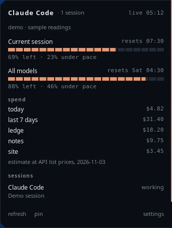
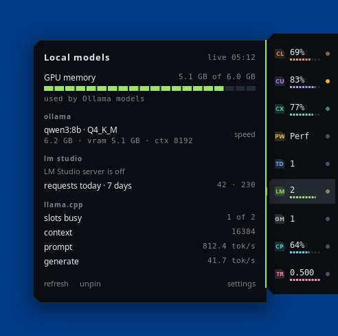
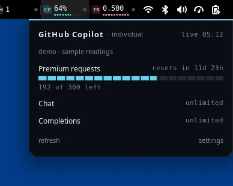
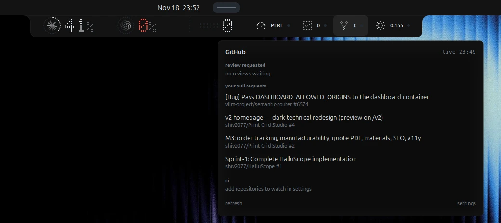
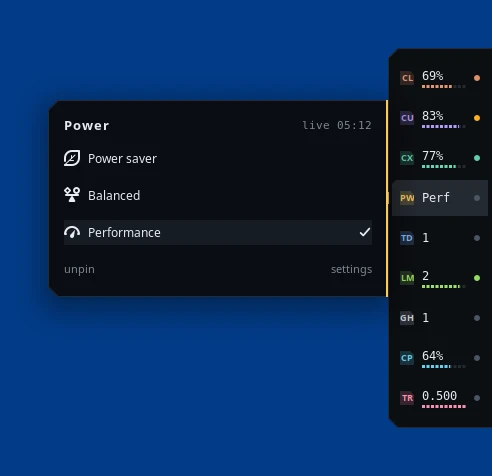
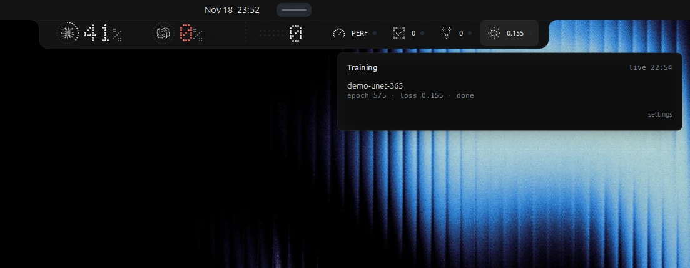
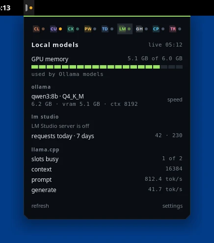

<div align="center">

# Ledge

**An instrument strip for GNOME Shell: the numbers you check all day, in the top bar or on a screen edge.**


</div>

Ledge puts a row of chips in the GNOME top bar, right after the clock. Each chip is one source: coding assistant limits, power profile, todos, local models, GitHub, Copilot and training runs. A chip shows a monogram, a monospaced readout, a small segmented meter and a status light. Click it and its deck drops down under the bar with the detail. Prefer the screen edge? Ledge can live there as a thin tick that unfolds into a rail.

Everything runs locally and asynchronously. Ledge stores no tokens.

## Contents

- [Highlights](#highlights)
- [Widgets](#widgets)
- [Top bar and screen edge](#top-bar-and-screen-edge)
- [Alerts](#alerts)
- [Appearance](#appearance)
- [Installation](#installation)
- [Usage](#usage)
- [Reporting training runs](#reporting-training-runs)
- [Privacy and security](#privacy-and-security)
- [How it works](#how-it-works)
- [Development](#development)
- [Troubleshooting](#troubleshooting)
- [Uninstalling](#uninstalling)
- [License](#license)

## Highlights

- **Readable at a glance.** Segmented meters, status lights and tabular numerals. Readouts never change width as values move.
- **Top bar or edge.** The strip sits in the top bar by default and folds down to readout-free chips, then to one summary chip, when the bar is crowded. On a screen edge it rests as a 4 px tick.
- **Knows when a session needs you.** A finished or waiting coding session plays a sound and, on the edge rail, briefly unfolds it. Usage limits notify at 80 % and 100 %.
- **Pace and spend.** Each limit window says whether you are ahead of or under an even pace. An estimate of the week's spend, per project, comes from your local transcripts.
- **Never blocks the desktop.** Every file read, subprocess and HTTP request is asynchronous with a timeout. A missing source shows a clear state in its deck.
- **Keyboard first.** Super+Shift+L opens Ledge, Tab walks every control, Escape closes.
- **Local by design.** No telemetry and no stored tokens. GitHub goes through the `gh` CLI; model servers are reached on localhost only.

## Widgets

<table>
<tr>
<td width="50%"></td>
<td width="50%"></td>
</tr>
<tr>
<td><b>Coding usage.</b> Claude Code, Cursor and Codex limit windows with resets, pace and live sessions. Click a session to raise its terminal or editor window. Extra sign-ins (<code>~/.claude-work</code>, <code>~/.codex-side</code>) get their own chips.</td>
<td><b>Local models.</b> Ollama models with size, VRAM, context and quantisation, a speed test, LM Studio's loaded models and request counts, and a llama.cpp server's slots and token rates.</td>
</tr>
<tr>
<td></td>
<td></td>
</tr>
<tr>
<td><b>Copilot.</b> Premium requests left this month and the reset date, read with <code>gh api</code>. Off by default.</td>
<td><b>GitHub.</b> Review requests, your open pull requests and the latest CI run for repositories you watch. The light turns red when a run fails.</td>
</tr>
<tr>
<td></td>
<td></td>
</tr>
<tr>
<td><b>Power.</b> The current power-profiles-daemon profile; click one to switch.</td>
<td><b>Training.</b> Live epoch progress with the loss as the readout, and notifications when a run finishes, crashes or stalls.</td>
</tr>
</table>

| Widget | Chip | Deck | Source |
| --- | --- | --- | --- |
| Claude Code, Cursor, Codex | Quota left in the chosen window | Windows, resets, pace, spend, sessions | Each tool's existing sign-in and local transcripts |
| Power | Active profile | Power Saver, Balanced, Performance | power-profiles-daemon over D-Bus |
| Todo | Open items | Add, complete, delete | `~/.local/share/ledge/todos.json` |
| Local models | Loaded models; meter is GPU memory in use | Models, request counts, slots, speeds | Ollama, LM Studio and llama.cpp on localhost, `nvidia-smi` |
| GitHub | Review requests; red on failing CI | Pull requests and CI, click to open | `gh` CLI |
| Copilot | Premium requests left | Every quota and its reset | `gh api /copilot_internal/user` |
| Training | Newest run's progress and loss | Recent runs with epoch, loss, ETA and state | `~/.local/share/ledge/runs/` |

## Top bar and screen edge

<table>
<tr>
<td width="50%"></td>
<td width="50%"></td>
</tr>
<tr>
<td><b>Top bar.</b> Click a chip to open its deck; hover another chip to switch. A crowded bar drops readouts, then shows one summary chip whose deck has a switcher.</td>
<td><b>Screen edge.</b> Rest the pointer on the tick to unfold the rail. Hover a chip for its deck. Right-click a chip, or choose <b>pin</b>, to keep its deck open.</td>
</tr>
</table>

Choose the place under **Where Ledge lives** in preferences, or run `gsettings set org.gnome.shell.extensions.ledge placement edge`. Switching takes effect at once.

## Alerts

| Event | What happens |
| --- | --- |
| A coding session finishes | The **Finished sound** plays; on the edge rail, Ledge unfolds for **Peek** seconds |
| A session waits on you | The **Waiting sound** plays, the chip light blinks amber and the rail peeks |
| A usage window reaches 80 % or 100 % | One notification each, re-armed when the window resets |

Do Not Disturb silences sounds and peeks. Peeks also stay away from fullscreen windows. Mute limit alerts per provider in preferences.

## Appearance

| Theme | Description |
| --- | --- |
| **Midnight** | Deep blue-black instrument panel. The default. |
| **Graphite** | Soft dark grey. |
| **Nord**, **Catppuccin Mocha**, **Dracula** | The well-known palettes. |
| **Ocean** | Deep navy. |
| **Snow** | Light. |
| **Frosted Dark**, **Frosted Light** | A live blur of whatever is behind the rail and deck, clipped to their chamfered outline. |
| **System** | Follows Ubuntu's light or dark style and your accent colour, live. |
| **Custom** | Your own colours and opacity. |

Every theme keeps text at 4.5:1 contrast and marks at 3:1 against any background it can land on. Tests enforce this for every built-in theme.

## Installation

**Requirements:** GNOME Shell 50 (Ubuntu 26.04), Python 3 and `glib-compile-schemas`, which ship with Ubuntu Desktop. Optional: `gh` for GitHub and Copilot; Ollama, LM Studio or llama.cpp for local models.

```sh
git clone https://github.com/shiv2077/Ledge.git
cd Ledge
make install
```

Log out and back in (Wayland discovers new extensions at login), then:

```sh
gnome-extensions enable ledge@shiv2077
gnome-extensions prefs ledge@shiv2077
```

`make package` writes a shareable zip to `dist/ledge@shiv2077.shell-extension.zip`.

## Usage

| Action | How |
| --- | --- |
| Open a deck | Click a chip in the top bar, or hover one on the edge rail |
| Keyboard | **Super+Shift+L** opens Ledge, **Tab** walks controls, **Escape** closes |
| Keep a deck open (edge) | Right-click its chip, or choose **pin** in the deck |
| Raise a session's window | Click the session row in a usage deck |
| Preview without accounts | Turn on **Demo readings** in preferences |

Preferences have one group per widget with its switch and options: which window a usage chip shows, chip order (fixed, least left first, or furthest ahead of pace first), countdown or clock reset times, hidden accounts, the llama.cpp port and refresh intervals.

## Reporting training runs

Add [`tools/ledge_status.py`](tools/ledge_status.py) to a training script. It has no dependencies beyond the Python standard library.

```python
from ledge_status import RunStatus

with RunStatus("resnet-cifar", total_epochs=10) as status:
    for epoch in range(1, 11):
        for step, batch in enumerate(loader):
            loss = train_step(batch)
            status.update(epoch=epoch, step=step, loss=loss, eta_seconds=eta)
```

Leaving the block marks the run done; an exception marks it crashed. A running job with no update for 10 minutes shows as stalled. Try it with `python3 tools/demo_training.py` (add `--crash` or `--stall`).

## Privacy and security

| Destination | Used by |
| --- | --- |
| Claude, Cursor and Codex usage endpoints | The usage reader, with each tool's existing local sign-in |
| GitHub | Only through the `gh` CLI, which owns authentication |
| `127.0.0.1` | Ollama (11434), LM Studio (1234) and llama.cpp (8080 by default). Other hosts are refused, redirects are not followed and proxies are bypassed |

There is no telemetry. Ledge stores no tokens and never logs credentials or message text. The spend estimate reads only model names, timestamps, folder names and token counts from transcripts. The LM Studio counter matches only request paths. Caches live in `~/.cache/ledge` with private permissions; todos and training runs stay in `~/.local/share/ledge`.

## How it works

Each widget is a module in [`modules/`](modules) with a small interface: one or more cells for the strip, a deck, and `start()` / `stop()`. The host in [`extension.js`](extension.js) hands the cells to the placement, either [`lib/panel.js`](lib/panel.js) or [`lib/rail.js`](lib/rail.js), which draw them with [`lib/strip.js`](lib/strip.js) and [`lib/deck.js`](lib/deck.js). Readers in [`reader/`](reader) run as short Python subprocesses. See [docs/ARCHITECTURE.md](docs/ARCHITECTURE.md), [DECISIONS.md](DECISIONS.md) and [docs/TESTING.md](docs/TESTING.md).


## Development

```sh
make test       # Node, Python and GJS tests, schema compile, syntax checks
make smoke      # a real headless GNOME Shell exercising every widget, placement and theme
make demo-assets  # README images from the smoke screenshots (ffmpeg)
make diagrams   # docs/diagrams from the code
make links      # check links in the docs
make nested     # a nested GNOME Shell window with this checkout (needs mutter-dev-bin)
make reload     # link this checkout and re-enable (settings and schema changes)
```

GJS caches ES modules for the life of the shell, so JavaScript changes need `make nested` or a fresh login. Follow the shell log with `journalctl --user -f -o cat /usr/bin/gnome-shell`.

## Troubleshooting

| Symptom | Fix |
| --- | --- |
| Extension "does not exist" after install | Log out and back in once. |
| Changes do not show after editing | GJS caches modules: log out and in, or use `make nested`. |
| Usage chip stale or dashed | Use the provider's own tool once, then press **refresh**. |
| Codex not found | Set `LEDGE_CODEX_BIN` in your login environment and log in again. |
| GitHub or Copilot says gh is missing or logged out | Install `gh` and run `gh auth login`. |
| Copilot says there is no plan | The signed-in GitHub account has no Copilot subscription. |
| llama.cpp shows no slots or speeds | Start `llama-server` with `--slots --metrics`. |

## Uninstalling

```sh
gnome-extensions disable ledge@shiv2077
rm -rf ~/.local/share/gnome-shell/extensions/ledge@shiv2077 ~/.cache/ledge
dconf reset -f /org/gnome/shell/extensions/ledge/
```

Your todos and training runs remain in `~/.local/share/ledge` until you delete that folder.

## License

Ledge is released under the MIT License. See [LICENSE](LICENSE). Notices for bundled third-party code are in [THIRD_PARTY_LICENSES](THIRD_PARTY_LICENSES).
