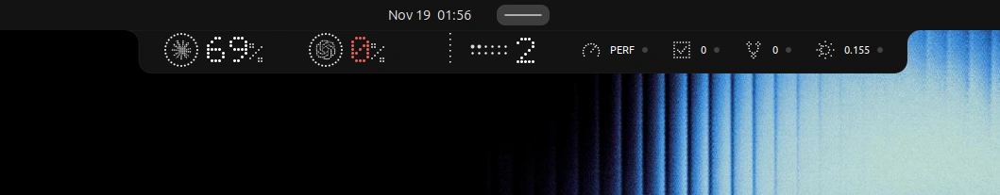
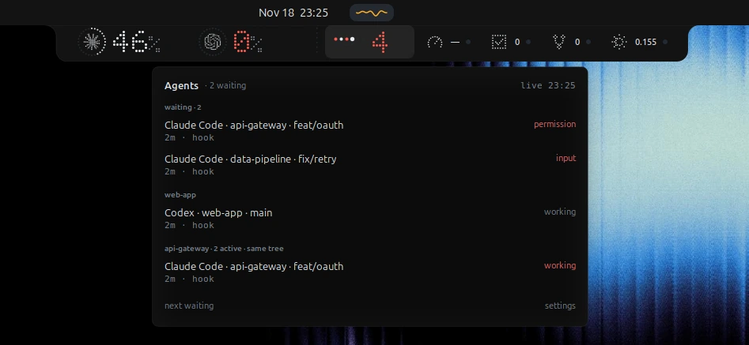
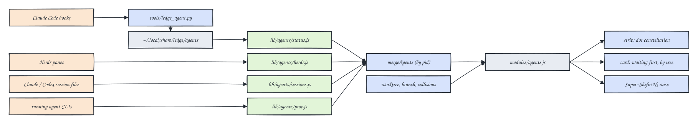
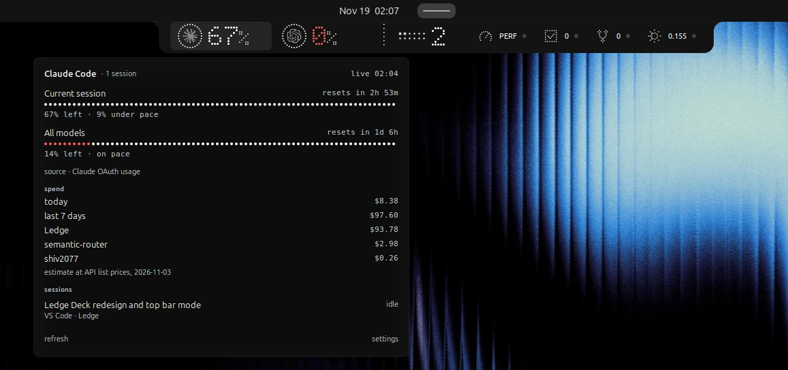
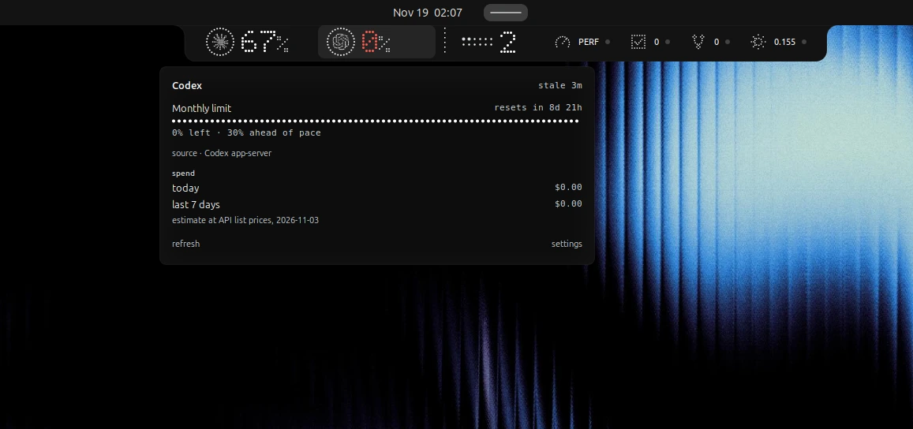
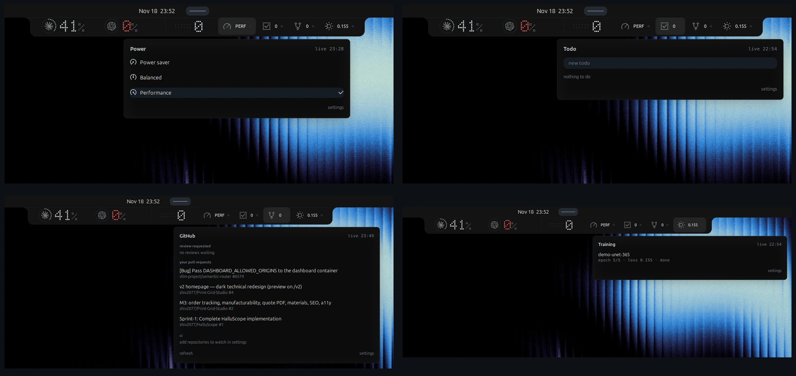
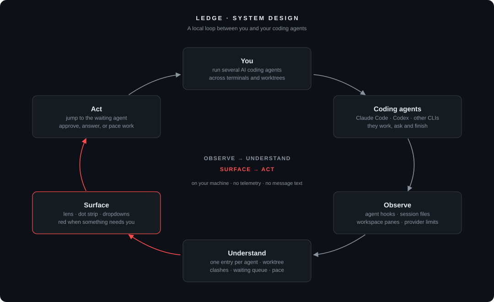

<div align="center">

# Ledge

**Your AI coding limits and every running agent, one glance from the GNOME top bar.**




</div>

Ledge is a GNOME Shell extension for people who code with several AI agents at once. It lives in the top bar as a small lens beside the clock:
- **at rest**, the lens shows a live trace that moves while an agent works and flashes red when one starts waiting on you;
- **hover it**, and a slim black strip drops out of the bar with your Claude Code and Codex limits, every running agent, and your power, todos, GitHub and training runs;
- **hover any item**, and its details drop down below it.

## Contents

- [Highlights](#highlights)
- [Multiple agents at a glance](#multiple-agents-at-a-glance)
- [Usage limits and spend](#usage-limits-and-spend)
- [Everything else in the strip](#everything-else-in-the-strip)
- [System design](#system-design)
- [Alerts](#alerts)
- [Appearance](#appearance)
- [Installation](#installation)
- [Usage](#usage)
- [Reporting training runs](#reporting-training-runs)
- [Privacy and security](#privacy-and-security)
- [Development](#development)
- [Troubleshooting](#troubleshooting)
- [Uninstalling](#uninstalling)
- [License](#license)

## Highlights

- **Multiple agents, one view.** Every Claude Code, Codex or other coding agent you run shows as a dot: white while it works, blinking red while it waits on you.
- **Jump to the agent that needs you.** **Super+Shift+N** raises the agent that has waited longest, down to its terminal pane.
- **Clash warnings.** Two agents active in the same git worktree get a red tag before they step on each other's changes.
- **Limits, pace and spend.** Each provider's quota is a dial. Its dropdown shows every limit window, whether you are ahead of or under pace, and today's and this week's estimated spend per project.
- **A design of its own.** A dot-matrix display style: white on matte black, with red kept for what needs you.
- **Local and private.** No telemetry, no stored tokens, and message text is never read. Every read is asynchronous, so the desktop never stalls.

## Multiple agents at a glance



Coding with AI now often means several agents at once, in separate terminals, panes and worktrees. Ledge keeps all of them in one place.

**In the strip:** each running agent is one dot. White means working, blinking red means waiting on you, and dim means idle. The count turns red while anyone is waiting.

**In the dropdown:**
1. **Waiting on you** comes first, with the reason: permission or input.
2. **Then one group per git worktree.** A red **2 active · same tree** tag marks agents working in the same tree.
3. **Each row** shows the tool, folder and branch, time in that state, and how Ledge knows it. Click a row to raise that agent's window or pane.



| Where agents are found | What Ledge learns | Tested by hand |
| --- | --- | --- |
| **Agent hooks** (Claude Code) | Exact states: working, waiting for permission or input, finished | yes |
| **Multi-agent terminal workspace** | Agents in each pane, exact states, and pane focus for the jump | yes |
| **Session files** (Claude Code, Codex) | Estimated states when no hook reports, marked ◦ | Claude yes, Codex not yet |
| **Running processes** | Any agent CLI (claude, codex, opencode, pi, amp, gemini, aider), shown as *running* | yes |

**Exact Claude Code states with hooks:**
1. Run `make agent-tools`. It installs the small hook writer, `tools/ledge_agent.py`, to `~/.local/share/ledge/tools/`.
2. Merge [`tools/hooks/claude-code-settings.json`](tools/hooks/claude-code-settings.json) into `~/.claude/settings.json`. Ledge never edits that file itself.
3. Under Preferences → Agents, press **Check** to confirm the hooks are in place.

The hook records only the session id, folder, state, the agent's process id and a time, never message text. Any script or tool can report the same way:

```sh
python3 ~/.local/share/ledge/tools/ledge_agent.py --id build-bot --tool mybot --state working --cwd .
```

## Usage limits and spend



**Claude Code.** Each limit window is a dotted bar with its reset time and pace, such as "17% ahead of pace". Below it is the estimated spend today and over 7 days, per project, read from your local transcripts at API list prices.



**Codex.** The same view for Codex limits.

A dial turns red when little is left. Extra sign-ins such as `~/.claude-work` or `~/.codex-side` get their own dials.

## Everything else in the strip



| Widget | What it does |
| --- | --- |
| **Power** (top left) | Shows the active power profile; click another to switch |
| **Todo** (top right) | Type and press Enter to add; tick to complete |
| **GitHub** (bottom left) | Review requests, your open pull requests and CI for repositories you watch, through the `gh` CLI |
| **Training** (bottom right) | Live epoch and loss for runs that report with `tools/ledge_status.py`, and a notice when one finishes, crashes or stalls |

Local models (Ollama, LM Studio, llama.cpp) and the GitHub Copilot quota can be switched on in Preferences.

## System design



Ledge closes one loop between you and your agents:

| Step | What happens |
| --- | --- |
| **You → Coding agents** | You start several agents across terminals and worktrees. They work, ask for permission or input, and finish |
| **Observe** | Ledge reads the signals agents already leave: hook events, session files, workspace panes, running processes and provider usage limits. Each source has its own switch, and every read runs in the background with a timeout |
| **Understand** | Signals become one entry per agent. Ledge adds each agent's worktree and branch, flags clashes, orders who has waited longest, and works out pace and spend |
| **Surface** | The lens, the dot strip and the dropdowns show it. Red appears only when something needs you |
| **Act** | You jump to the waiting agent, approve or answer it, or pace your work. The agents carry on and the loop repeats |

Everything stays on your machine. More detail is in [docs/ARCHITECTURE.md](docs/ARCHITECTURE.md), [DECISIONS.md](DECISIONS.md) and [docs/TESTING.md](docs/TESTING.md). Both diagrams have an editable Excalidraw file beside them in [`docs/diagrams/`](docs/diagrams).

## Alerts

| Event | What happens |
| --- | --- |
| A coding session finishes | The strip opens for **Peek** seconds; the **Finished sound** plays if sounds are on |
| A session waits on you | The lens flashes red, its dot blinks red, and the strip opens; the **Waiting sound** plays if sounds are on |
| A usage window reaches 80 % or 100 % | One notification each, re-armed when the window resets |

Do Not Disturb silences sounds and peeks. Peeks also stay away from fullscreen windows. Mute limit alerts per provider in preferences.

## Appearance

| Theme | Description |
| --- | --- |
| **Midnight** | Matte black. The default. |
| **Graphite** | Soft dark grey. |
| **Nord**, **Catppuccin Mocha**, **Dracula** | The well-known palettes. |
| **Ocean** | Deep navy. |
| **Snow** | Light. |
| **System** | Follows Ubuntu's light or dark style and your accent colour, live. |
| **Custom** | Your own colours and opacity. |

Every theme keeps text at 4.5:1 contrast and marks at 3:1 against any background it can land on. Tests enforce this for every built-in theme.

## Installation

**Requirements:** GNOME Shell 50 (Ubuntu 26.04), Python 3 and `glib-compile-schemas`, which ship with Ubuntu Desktop. Optional: `gh` for GitHub and Copilot; Ollama, LM Studio or llama.cpp for local models.

```sh
git clone https://github.com/shiv2077/Ledge.git
cd Ledge
make install
```

Log out and back in (Wayland discovers new extensions at login), then:

```sh
gnome-extensions enable ledge@shiv2077
gnome-extensions prefs ledge@shiv2077
```

`make package` writes a shareable zip to `dist/ledge@shiv2077.shell-extension.zip`.

## Usage

| Action | How |
| --- | --- |
| Open the strip | Hover or click the lens beside the clock; hover a dial for its dropdown |
| Next waiting agent | **Super+Shift+N** |
| Keyboard | **Super+Shift+L** opens Ledge, **Tab** walks controls, **Escape** closes |
| Raise a session's window | Click the session row in a usage deck |
| Preview without accounts | Turn on **Demo readings** in preferences |

Preferences have one group per widget with its switch and options: which window a usage dial shows, dial order (fixed, least left first, or furthest ahead of pace first), countdown or clock reset times, hidden accounts, the llama.cpp port and refresh intervals.

## Reporting training runs

Add [`tools/ledge_status.py`](tools/ledge_status.py) to a training script. It has no dependencies beyond the Python standard library.

```python
from ledge_status import RunStatus

with RunStatus("resnet-cifar", total_epochs=10) as status:
    for epoch in range(1, 11):
        for step, batch in enumerate(loader):
            loss = train_step(batch)
            status.update(epoch=epoch, step=step, loss=loss, eta_seconds=eta)
```

Leaving the block marks the run done; an exception marks it crashed. A running job with no update for 10 minutes shows as stalled. Try it with `python3 tools/demo_training.py` (add `--crash` or `--stall`).

## Privacy and security

| Destination | Used by |
| --- | --- |
| Claude, Cursor and Codex usage endpoints | The usage reader, with each tool's existing local sign-in |
| GitHub | Only through the `gh` CLI, which owns authentication |
| `127.0.0.1` | Ollama (11434), LM Studio (1234) and llama.cpp (8080 by default). Other hosts are refused, redirects are not followed and proxies are bypassed |

There is no telemetry. Ledge stores no tokens and never logs credentials or message text. The spend estimate reads only model names, timestamps, folder names and token counts from transcripts. The LM Studio counter matches only request paths. Caches live in `~/.cache/ledge` with private permissions; todos and training runs stay in `~/.local/share/ledge`.

## Development

```sh
make test       # Node, Python and GJS tests, schema compile, syntax checks
make smoke      # a real headless GNOME Shell exercising every widget and theme
make diagrams   # the system design diagrams in docs/diagrams
make links      # check links in the docs
make nested     # a nested GNOME Shell window with this checkout (needs mutter-dev-bin)
make reload     # link this checkout and re-enable (settings and schema changes)
```

GJS caches ES modules for the life of the shell, so JavaScript changes need `make nested` or a fresh login. Follow the shell log with `journalctl --user -f -o cat /usr/bin/gnome-shell`.

## Troubleshooting

| Symptom | Fix |
| --- | --- |
| Extension "does not exist" after install | Log out and back in once. |
| Changes do not show after editing | GJS caches modules: log out and in, or use `make nested`. |
| Usage dial stale or dashed | Use the provider's own tool once, then press **refresh**. |
| Codex not found | Set `LEDGE_CODEX_BIN` in your login environment and log in again. |
| GitHub or Copilot says gh is missing or logged out | Install `gh` and run `gh auth login`. |
| Copilot says there is no plan | The signed-in GitHub account has no Copilot subscription. |
| llama.cpp shows no slots or speeds | Start `llama-server` with `--slots --metrics`. |

## Uninstalling

```sh
gnome-extensions disable ledge@shiv2077
rm -rf ~/.local/share/gnome-shell/extensions/ledge@shiv2077 ~/.cache/ledge
dconf reset -f /org/gnome/shell/extensions/ledge/
```

Your todos and training runs remain in `~/.local/share/ledge` until you delete that folder.

## License

Ledge is released under the MIT License. See [LICENSE](LICENSE). Notices for bundled third-party code are in [THIRD_PARTY_LICENSES](THIRD_PARTY_LICENSES).
