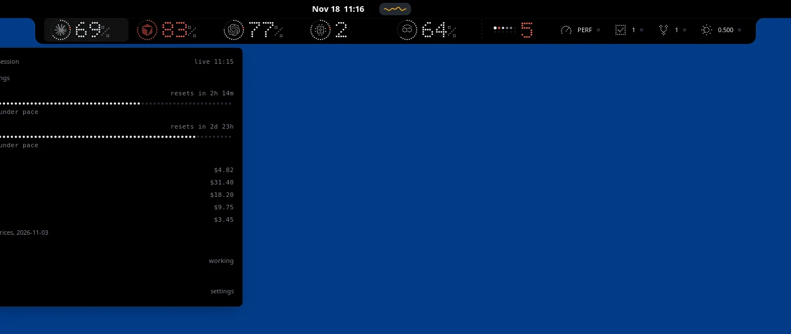
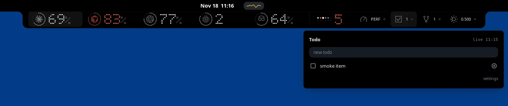
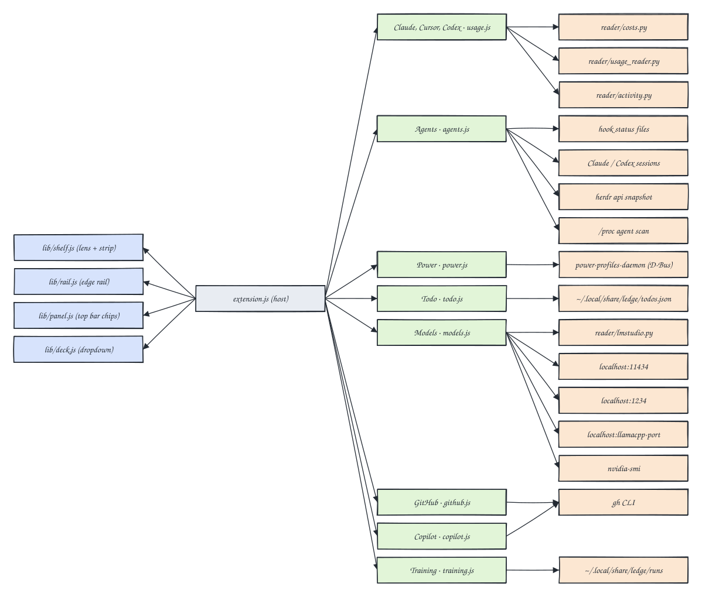

<div align="center">

# Ledge

**A dot-matrix strip for GNOME Shell: your coding limits and every running agent, one glance from the top bar.**




</div>

A small lens sits beside the clock. It shows a live trace that moves while an agent works and flashes red when one starts waiting on you. Hover it, and a slim black strip grows out of the top bar:
- dot dials for Claude Code, Cursor, Codex, Copilot and local models;
- a constellation of every coding agent you have running;
- power, todos, GitHub and training runs.

Hover any of them and its detail drops down. Everything is local and asynchronous. Ledge stores no tokens and never reads message text.

## Contents

- [Highlights](#highlights)
- [Agents](#agents)
- [Widgets](#widgets)
- [Placements](#placements)
- [Alerts](#alerts)
- [Appearance](#appearance)
- [Installation](#installation)
- [Usage](#usage)
- [Reporting training runs](#reporting-training-runs)
- [Privacy and security](#privacy-and-security)
- [How it works](#how-it-works)
- [Development](#development)
- [Troubleshooting](#troubleshooting)
- [Uninstalling](#uninstalling)
- [License](#license)

## Highlights

- **Every agent at a glance.** One dot per running agent: white while it works, blinking red while it waits on you. Hover for the list, grouped by worktree, with the waiting agents first.
- **Jump to who needs you.** **Super+Shift+N** raises the agent that has waited longest, and through Herdr it focuses the exact pane.
- **Collisions.** Two agents working in the same worktree get a red tag.
- **Limits, pace and spend.** Dials show quota left, the dropdown shows each window's pace, and Claude's dropdown estimates today's and the week's spend per project.
- **Never blocks the desktop.** Every read, subprocess and request is asynchronous with a timeout.
- **Local by design.** No telemetry, no stored tokens, no new network hosts.

## Agents


| Source | What it gives | Tested by hand (GNOME 50, Nov 2026) |
| --- | --- | --- |
| **Hook status files** (`~/.local/share/ledge/agents/`) | Exact states from Claude Code hooks or any script: working, waiting (permission or input) and finished | yes |
| **Claude Code sessions** | Working, waiting and idle, guessed from session files when no hook reports (marked ◦) | yes |
| **Codex sessions** | Working and idle, guessed from Codex session files (marked ◦) | not yet |
| **Herdr** | Every agent in your Herdr panes, with exact states and pane focus. Read with `herdr api snapshot` only while Herdr's socket exists | listing yes; pane focus not yet |
| **Running processes** | Agent command-line tools found in `/proc` (claude, codex, opencode, pi, amp, gemini, aider), shown as *running* only | yes |


The same agent seen by several sources shows once. The state comes from the most exact source: a hook, then Herdr, then a session guess, then a bare process. Each source has its own switch under Preferences → Agents.

**Exact Claude Code states with hooks:**
1. Run `make agent-tools`. It installs `tools/ledge_agent.py` to `~/.local/share/ledge/tools/`.
2. Merge [`tools/hooks/claude-code-settings.json`](tools/hooks/claude-code-settings.json) into `~/.claude/settings.json`. Ledge never edits that file itself. **Check** under Preferences → Agents confirms the hooks are in place.

The hook writes the session id, folder, state, the agent's pid and a time. Message text is never stored. Any script can report the same way:

```sh
python3 ~/.local/share/ledge/tools/ledge_agent.py --id build-bot --tool mybot --state working --cwd .
```

## Widgets

<table>
<tr>
<td width="50%"></td>
<td width="50%"></td>
</tr>
<tr>
<td><b>Coding usage.</b> Claude Code, Cursor and Codex limit windows with resets, pace and live sessions. Click a session to raise its window. Extra sign-ins (<code>~/.claude-work</code>, <code>~/.codex-side</code>) get their own dials.</td>
<td><b>Todo, power, GitHub, training.</b> Add todos, switch power profiles, see review requests and CI, and follow training runs, each from its own dropdown.</td>
</tr>
</table>

| Widget | Strip | Dropdown | Source |
| --- | --- | --- | --- |
| Claude Code, Cursor, Codex | Dial of quota left | Windows, resets, pace, spend, sessions | Each tool's existing sign-in and local files |
| Agents | Dot constellation and count | Waiting first, then by worktree | Hooks, Herdr, sessions, `/proc` |
| Copilot | Dial of premium requests left | Every quota and its reset | `gh api /copilot_internal/user` (off by default) |
| Local models | Loaded models | Ollama, LM Studio and llama.cpp details | localhost, `nvidia-smi` |
| Power | Active profile | Power Saver, Balanced, Performance | power-profiles-daemon over D-Bus |
| Todo | Open items | Add, complete, delete | `~/.local/share/ledge/todos.json` |
| GitHub | Review requests | Pull requests and CI | `gh` CLI |
| Training | Newest run's loss | Recent runs | `~/.local/share/ledge/runs/` |

## Placements

The strip under the top bar is the default. Preferences → Where Ledge lives also offers chips in the top bar, or a rail on any screen edge.

<table>
<tr>
<td width="50%"></td>
<td width="50%"></td>
</tr>
</table>

## Alerts

| Event | What happens |
| --- | --- |
| A coding session finishes | The **Finished sound** plays; on the edge rail, Ledge unfolds for **Peek** seconds |
| A session waits on you | The **Waiting sound** plays, the chip light blinks amber and the rail peeks |
| A usage window reaches 80 % or 100 % | One notification each, re-armed when the window resets |

Do Not Disturb silences sounds and peeks. Peeks also stay away from fullscreen windows. Mute limit alerts per provider in preferences.

## Appearance

| Theme | Description |
| --- | --- |
| **Midnight** | Deep blue-black instrument panel. The default. |
| **Graphite** | Soft dark grey. |
| **Nord**, **Catppuccin Mocha**, **Dracula** | The well-known palettes. |
| **Ocean** | Deep navy. |
| **Snow** | Light. |
| **Frosted Dark**, **Frosted Light** | A live blur of whatever is behind the rail and deck, clipped to their chamfered outline. |
| **System** | Follows Ubuntu's light or dark style and your accent colour, live. |
| **Custom** | Your own colours and opacity. |

Every theme keeps text at 4.5:1 contrast and marks at 3:1 against any background it can land on. Tests enforce this for every built-in theme.

## Installation

**Requirements:** GNOME Shell 50 (Ubuntu 26.04), Python 3 and `glib-compile-schemas`, which ship with Ubuntu Desktop. Optional: `gh` for GitHub and Copilot; Ollama, LM Studio or llama.cpp for local models.

```sh
git clone https://github.com/shiv2077/Ledge.git
cd Ledge
make install
```

Log out and back in (Wayland discovers new extensions at login), then:

```sh
gnome-extensions enable ledge@shiv2077
gnome-extensions prefs ledge@shiv2077
```

`make package` writes a shareable zip to `dist/ledge@shiv2077.shell-extension.zip`.

## Usage

| Action | How |
| --- | --- |
| Open the strip | Hover or click the lens beside the clock; hover a dial for its dropdown |
| Next waiting agent | **Super+Shift+N** |
| Keyboard | **Super+Shift+L** opens Ledge, **Tab** walks controls, **Escape** closes |
| Keep a deck open (edge) | Right-click its chip, or choose **pin** in the deck |
| Raise a session's window | Click the session row in a usage deck |
| Preview without accounts | Turn on **Demo readings** in preferences |

Preferences have one group per widget with its switch and options: which window a usage chip shows, chip order (fixed, least left first, or furthest ahead of pace first), countdown or clock reset times, hidden accounts, the llama.cpp port and refresh intervals.

## Reporting training runs

Add [`tools/ledge_status.py`](tools/ledge_status.py) to a training script. It has no dependencies beyond the Python standard library.

```python
from ledge_status import RunStatus

with RunStatus("resnet-cifar", total_epochs=10) as status:
    for epoch in range(1, 11):
        for step, batch in enumerate(loader):
            loss = train_step(batch)
            status.update(epoch=epoch, step=step, loss=loss, eta_seconds=eta)
```

Leaving the block marks the run done; an exception marks it crashed. A running job with no update for 10 minutes shows as stalled. Try it with `python3 tools/demo_training.py` (add `--crash` or `--stall`).

## Privacy and security

| Destination | Used by |
| --- | --- |
| Claude, Cursor and Codex usage endpoints | The usage reader, with each tool's existing local sign-in |
| GitHub | Only through the `gh` CLI, which owns authentication |
| `127.0.0.1` | Ollama (11434), LM Studio (1234) and llama.cpp (8080 by default). Other hosts are refused, redirects are not followed and proxies are bypassed |

There is no telemetry. Ledge stores no tokens and never logs credentials or message text. The spend estimate reads only model names, timestamps, folder names and token counts from transcripts. The LM Studio counter matches only request paths. Caches live in `~/.cache/ledge` with private permissions; todos and training runs stay in `~/.local/share/ledge`.

## How it works

Each widget is a module in [`modules/`](modules) with a small interface: one or more cells for the strip, a deck, and `start()` / `stop()`. The host in [`extension.js`](extension.js) hands the cells to the placement: [`lib/shelf.js`](lib/shelf.js) (the default strip), [`lib/panel.js`](lib/panel.js) or [`lib/rail.js`](lib/rail.js). Agent sources live in [`lib/agents/`](lib/agents) and are merged by [`modules/agents.js`](modules/agents.js). Readers in [`reader/`](reader) run as short Python subprocesses. See [docs/ARCHITECTURE.md](docs/ARCHITECTURE.md), [DECISIONS.md](DECISIONS.md) and [docs/TESTING.md](docs/TESTING.md).



## Development

```sh
make test       # Node, Python and GJS tests, schema compile, syntax checks
make smoke      # a real headless GNOME Shell exercising every widget, placement and theme
make demo-assets  # README images from the smoke screenshots (ffmpeg)
make diagrams   # docs/diagrams from the code
make links      # check links in the docs
make nested     # a nested GNOME Shell window with this checkout (needs mutter-dev-bin)
make reload     # link this checkout and re-enable (settings and schema changes)
```

GJS caches ES modules for the life of the shell, so JavaScript changes need `make nested` or a fresh login. Follow the shell log with `journalctl --user -f -o cat /usr/bin/gnome-shell`.

## Troubleshooting

| Symptom | Fix |
| --- | --- |
| Extension "does not exist" after install | Log out and back in once. |
| Changes do not show after editing | GJS caches modules: log out and in, or use `make nested`. |
| Usage chip stale or dashed | Use the provider's own tool once, then press **refresh**. |
| Codex not found | Set `LEDGE_CODEX_BIN` in your login environment and log in again. |
| GitHub or Copilot says gh is missing or logged out | Install `gh` and run `gh auth login`. |
| Copilot says there is no plan | The signed-in GitHub account has no Copilot subscription. |
| llama.cpp shows no slots or speeds | Start `llama-server` with `--slots --metrics`. |

## Uninstalling

```sh
gnome-extensions disable ledge@shiv2077
rm -rf ~/.local/share/gnome-shell/extensions/ledge@shiv2077 ~/.cache/ledge
dconf reset -f /org/gnome/shell/extensions/ledge/
```

Your todos and training runs remain in `~/.local/share/ledge` until you delete that folder.

## License

Ledge is released under the MIT License. See [LICENSE](LICENSE). Notices for bundled third-party code are in [THIRD_PARTY_LICENSES](THIRD_PARTY_LICENSES).
