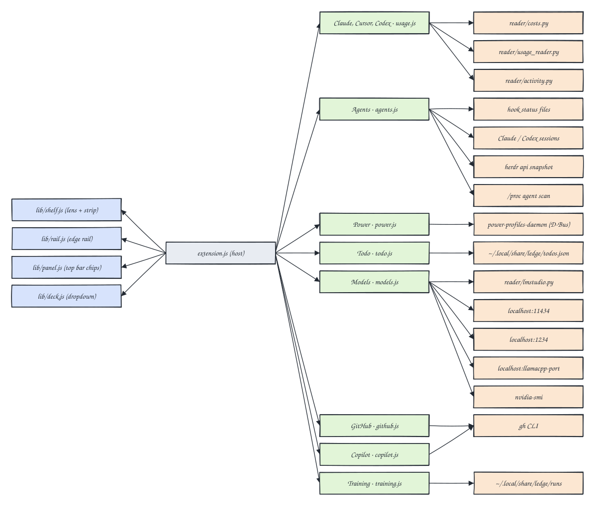
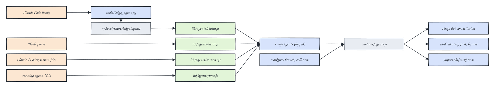
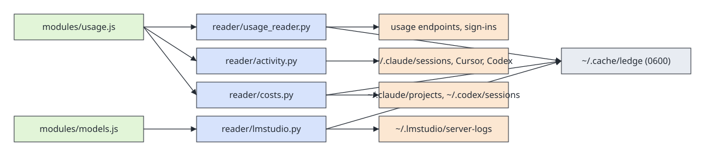

# Architecture

Ledge is a GNOME Shell 50 extension written as ES modules for GJS, with a few Python 3 readers run as subprocesses. Nothing in it blocks the shell's main loop: file reads, subprocesses and HTTP are all asynchronous with timeouts.

The diagrams are generated from the code by `make diagrams` ([`scripts/diagrams.py`](../scripts/diagrams.py)). Each has an `.excalidraw` scene beside its SVG; open it at excalidraw.com, or in any Excalidraw editor, to rearrange or annotate it.

## Host

[`extension.js`](../extension.js) owns the settings, the modules, the theme and the keyboard shortcut. It starts a module while its GSettings switch is on and stops it when the switch turns off or the extension is disabled. Module updates are coalesced into one redraw per idle. The host builds the cell list (`_cells()`), orders usage cells by `usage-order`, and hands the list to the placement. It also handles alerts from modules: sounds through the shell's sound player and, on the edge, a peek of the rail.

## Placements

| File | Role |
| --- | --- |
| [`lib/shelf.js`](../lib/shelf.js) | The default. A lens beside the clock with a live trace; hovering opens a slim strip that grows out of the bar: dot dials, the agent constellation and stats. Hovering an item drops its detail card below it |
| [`lib/panel.js`](../lib/panel.js) | Top bar. A `PanelMenu.Button` holds the strip; its `PopupMenu` hosts the deck with the menu's own chrome removed. An empty twin before the clock keeps the clock centred. `stripMode()` picks full, compact or summary chips from the space available |
| [`lib/rail.js`](../lib/rail.js) | Screen edge. A 4 px tick with the most urgent light, hover intent, unfold and fold on one frame-clock timeline, deck docking, pin, peek and keyboard focus |
| [`lib/strip.js`](../lib/strip.js) | The chips: badge, mono readout, chip meter, light. Shared by both placements |
| [`lib/deck.js`](../lib/deck.js) | The deck: header with title, context and timestamp; body from the module's `card()`; footer actions with `settings` last |

Switching placement destroys one and builds the other without a restart.

## Modules

Each module in [`modules/`](../modules) extends `Module` from [`lib/module.js`](../lib/module.js):

- `start()` / `stop()` begin and end polling or monitoring.
- `cell()` returns the chip: `meter`, `fraction`, `label`, `badge`, `light`, `accent`, `stale`, `updatedAt`.
- `cells()` is optional and returns several `{key, info}` cells. The usage modules return one per account (`claude`, `claude:work`).
- `heading(key)`, `context(key)` and `card(body, ui, key)` fill the deck.

Fixed chip order: claude, cursor, codex, power, todo, models, github, copilot, training.

## Agent radar

[`modules/agents.js`](../modules/agents.js) merges agents from adapters in [`lib/agents/`](../lib/agents):
- **Hook status files.** [`tools/ledge_agent.py`](../tools/ledge_agent.py), run by Claude Code hooks, writes them.
- **A multi-agent terminal workspace's `api snapshot`.** It is run only while the workspace's socket exists, and only after a protocol check.
- **Claude Code and Codex sessions,** from the usage readers.
- **A `/proc` scan** for agent command-line tools.

How they combine:
- **Joining:** agents join by pid. An agent without a pid joins another by folder and tool only when exactly one candidate fits.
- **State** comes from the most exact source: hook, then the workspace, then a session guess, then a bare process.
- **Worktree and branch** are read from `.git` and cached, with no git subprocess. Two or more active agents in one worktree are flagged.
- **Super+Shift+N** raises the agent that has waited longest. Through the workspace it focuses that agent's pane.

## Readers

| Reader | Output |
| --- | --- |
| [`reader/usage_reader.py`](../reader/usage_reader.py) | Limit windows per provider and account, with `windowMinutes` and `resetsAt` |
| [`reader/activity.py`](../reader/activity.py) | Live sessions with state, title, pid (Claude, Cursor) or working folder (Codex) |
| [`reader/costs.py`](../reader/costs.py) | Estimated spend today and over seven days, per project, from an incremental index |
| [`reader/lmstudio.py`](../reader/lmstudio.py) | LM Studio request counts from its server logs |

Readers print one JSON document and exit. They never print tokens or message text.

## Shared helpers

| File | Role |
| --- | --- |
| [`lib/subprocess.js`](../lib/subprocess.js) | `run(argv, {timeout, cancellable})`, killed on timeout or cancel, never rejects |
| [`lib/http.js`](../lib/http.js) | `getJson`, `postJson`, `getText`: localhost only, no redirects, no proxy |
| [`lib/files.js`](../lib/files.js) | Async reads and atomic writes |
| [`lib/alerts.js`](../lib/alerts.js) | Pure rules for session events and limit steps |
| [`lib/windows.js`](../lib/windows.js) | Finds and raises the window that runs a session |
| [`lib/appearance.js`](../lib/appearance.js), [`themes.js`](../themes.js) | Theme tokens, contrast fitting, generated stylesheet |
| [`design.js`](../design.js), [`draw.js`](../draw.js) | Sizes, motion curves, chamfer geometry and Cairo drawing |
| [`model.js`](../model.js) | Pure helpers for readings, pace, ordering and parsers; tested with Node |

## Lifecycle

`disable()` stops every module, then destroys the placement and the appearance watcher. Modules cancel their `Gio.Cancellable`, remove their timers and disconnect their signals. State that must survive the lock screen (limit alert steps, training notices) lives at module scope.
